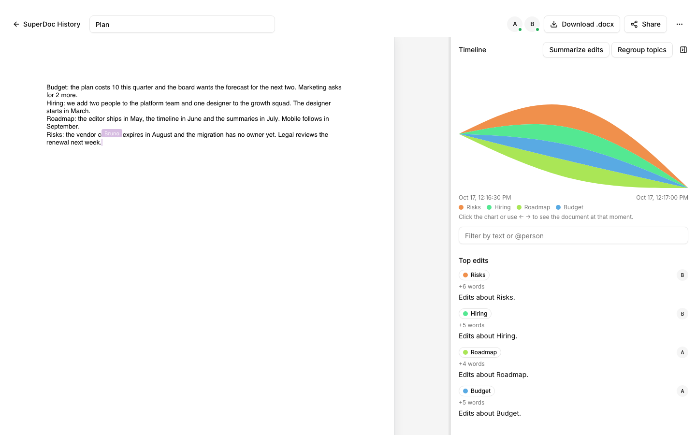

# SuperDoc Collab

A collaborative DOCX editor that records every edit and shows who changed what, and when: a timeline per topic, time travel to any moment, and model-written summaries of the edits you select. Built on SuperDoc for its take-home brief ([`docs/brief/`](docs/brief/superdoc-eng-sample-project.docx)).

**Live demo:** <https://superdoc.dhyegocalota.com.br>. Accounts are by invitation: sign in as `ana@example.com` with the password from the delivery message, and open a second browser as `bruno@example.com` to edit together.



## Quick install

**With an agent.** Paste this into Claude Code, Codex or any agent with a shell; it asks you one question, installs, and stops where only you can continue:

```text
Install https://github.com/dhyegocalota/superdoc-collab by following docs/agent-install.md in that repository.
```

**With Docker**, as a local demo with seeded users:

```bash
ENV_FILE=.env.example APP_ORIGIN=http://localhost:3000 SEED_DEMO_USERS=true docker compose up --build -d
```

Open <http://localhost:3000> and sign in as `ana@example.com` / `superdoc-demo`. The demo users are Ana, Bruno, Caio and Dani at `example.com`, all with that password. `docker compose down -v` resets everything. Topics and summaries need `OPENROUTER_API_KEY`; without it the app works and the chart shows one band per author.

Railway, running from source, configuration and recovery: [Install and run](docs/install.md).

## Read more

- [Install and run](docs/install.md): Docker, Railway or an agent, then claim the instance and invite your team; [develop with an agent](docs/install.md#develop-with-an-agent)
- [Architecture, features and limits](docs/architecture.md)
- [Decisions](docs/adr/) and [features](docs/features/README.md#roadmap), one folder and one pull request each
- [Why there are no comments](docs/why-no-comments.md): where the why lives instead
- [How the work is done](.claude/HARNESS.md) with Claude Code, and the [credits](docs/credits.md)

## License

[GNU AGPL-3.0](LICENSE), the same licence as SuperDoc and its SDK. Copyright 2026 Dhyego Calota.
