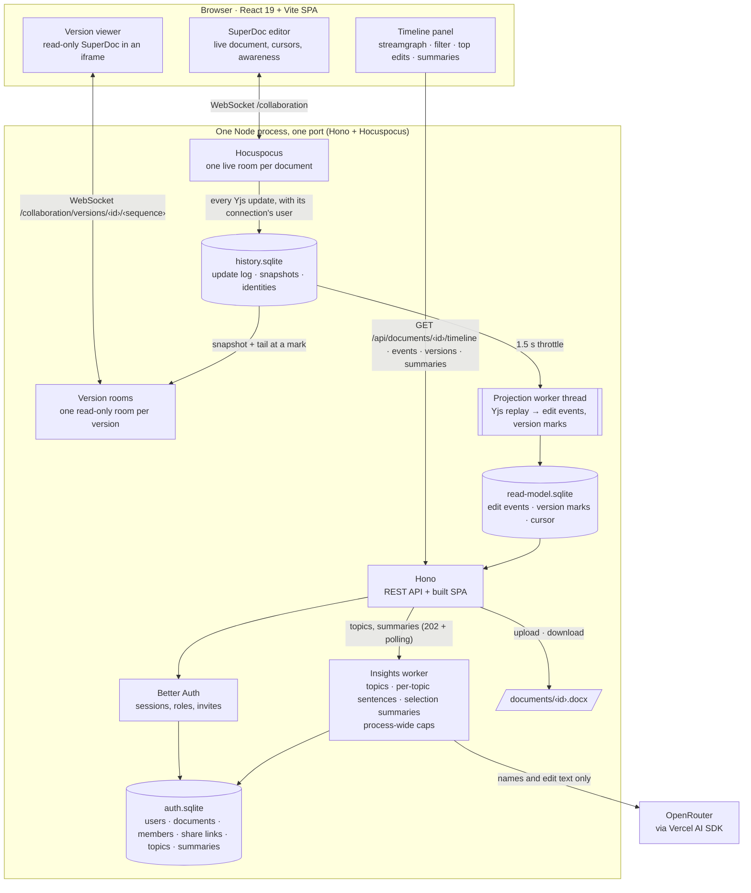

# SuperDoc History

A collaborative DOCX editor that records every edit and turns that record into a timeline of who changed what and when, with time travel and LLM-written summaries. Access is by invitation: the first account claims the instance and becomes its administrator, and everyone else joins through a single-use invite link. It is the take-home project for SuperDoc ([brief](docs/brief/superdoc-eng-sample-project.docx)); the design rationale is in [`docs/adr/`](docs/adr/).

Live demo: <https://superdoc-collab.up.railway.app> (Railway, [ADR 0019](docs/adr/0019-deploy-on-railway.md)). Repository: <https://github.com/dhyegocalota/superdoc-take-home>. Every slice, its spec and its pull request are listed in the [roadmap](docs/features/README.md#roadmap).

| | |
|---|---|
|  |  |
| Two authors edit the same document live, each seeing the other's cursor | The timeline panel: one band per topic, named by the model |
|  | |
| The admin page: generate, copy and revoke single-use invite links | |

## Quick start

Requirements: Docker with Compose v2.

```bash
cp .env.example .env
sed -i.bak "s|^AUTH_SECRET=.*|AUTH_SECRET=$(openssl rand -base64 48)|; s|^APP_ORIGIN=.*|APP_ORIGIN=http://localhost:3000|" .env
docker compose up --build -d
```

Open <http://localhost:3000> and claim the instance: the first account you create becomes the administrator. `docker compose down -v` erases all data and returns the instance to unclaimed. The healthcheck calls `/api/health`.

## Install on Railway

The [Railway runbook](docs/features/deploy/runbook-railway.md) creates the service, the volume and the variables, checks the deploy, claims the instance and rolls back. The service is built from [`docker/Dockerfile`](docker/Dockerfile) with a volume at `/data`, one replica and Railway's TLS domain ([ADR 0019](docs/adr/0019-deploy-on-railway.md)). [`deploy/docker-compose.yml`](deploy/docker-compose.yml) documents the same environment for any compose host. CI builds and boots the image on every pull request.

## Install with an agent

Paste this into Claude Code, Codex or any agent with a shell. It installs the app and stops where only you can continue.

```text
Install https://github.com/dhyegocalota/superdoc-take-home for me.

1. Clone the repository and read README.md and docs/features/deploy/runbook-railway.md.
2. Ask me one question: Railway (hosted, about US$5/month) or Docker Compose on this machine. Do not continue until I answer.
3. Generate AUTH_SECRET with `openssl rand -base64 48`. Set the environment the runbook lists: PORT=3000, DATABASE_DIR=/data, WEB_DIST_DIR=/app/web, TRUST_PROXY=true (Railway) or false (local), APP_ORIGIN=<the public URL>, SEED_DEMO_USERS=false, and, if I give you an OpenRouter key, OPENROUTER_API_KEY and LLM_MODEL. Never print a secret.
4. Railway: follow the runbook steps 1 to 5 with the Railway CLI (I will run `railway login` when you ask). Docker: `docker compose up --build -d` with the variables above.
5. Verify: GET /api/health answers 200 and GET /api/setup answers {"claimed":false}.
6. Print the URL and stop. Tell me to open it and claim the instance: the first account created becomes the administrator, and sign-up closes behind it. Then tell me that /admin generates single-use invite links for my team.
```

## First login

Open the URL the install printed. An unclaimed instance shows "Claim this instance": create your account there. You are the administrator and sign-up closes behind you. Until you claim it anyone who finds the URL could, so do it right after the deploy.

## Invite your team

1. Open `/admin` and choose **Generate invite**.
2. Copy the link from the dialog and send it. The app sends no email.
3. The invitee opens the link, creates an account and lands in the documents list. Each link works once and expires after 7 days.

Pending invites can be revoked on the same page, and an administrator can promote or demote others; the last administrator cannot be demoted.

Then try it: upload a `.docx` or start a blank document, type a few sentences, **Share** it and edit next to a teammate. **Toggle timeline** shows the edits per topic, a click on the chart opens the document as it was then (**Back to live** returns), `@name` filters by author, and **Summarize edits** writes one to three sentences about the edits on screen.

## Configuration

The server reads these from the environment; there is no dotenv loader. [`.env.example`](.env.example) lists them with local values.

| Variable | Default | Purpose |
|---|---|---|
| `APP_ORIGIN` | none, required | The public origin: `https://<domain>`, no path, no trailing slash. A mismatch makes sign-in answer 403 |
| `AUTH_SECRET` | none, required | Signs sessions; generate with `openssl rand -base64 48`. Never reuse the placeholder in `.env.example` |
| `PORT` | `3000` | Port of the one Node process |
| `DATABASE_DIR` | `./data` (`/data` in the image) | Where the SQLite files and `documents/<id>.docx` live; mount a volume here |
| `WEB_DIST_DIR` | `/app/web` in the image | The built SPA the server serves |
| `TRUST_PROXY` | `false` | `true` only behind a proxy that overwrites `X-Forwarded-For` (Railway) |
| `OPENROUTER_API_KEY` | empty | The model key; empty keeps the app running without topics and summaries |
| `LLM_MODEL` | `openai/gpt-6-luna` in `.env.example` | The OpenRouter model id |
| `OPENROUTER_BASE_URL` | empty | Another OpenRouter-compatible endpoint; tests point it at a fake |
| `LLM_MAX_CONCURRENT_JOBS` | `2` | Model jobs at once, for the whole server ([ADR 0011](docs/adr/0011-process-wide-llm-cost-caps.md)) |
| `LLM_MAX_CALLS_PER_HOUR` | `60` | Model calls per rolling hour, for the whole server |
| `SEED_DEMO_USERS` | `false` | Tests only: `true` seeds four demo users and a test administrator on start. Production sets `false` ([ADR 0020](docs/adr/0020-invite-only-accounts-with-a-first-claim-admin.md)) |
| `DEMO_PASSWORD` | `superdoc-demo` in `.env.example` | Tests only: the seeded accounts' password, required when `SEED_DEMO_USERS=true` |

## How it works

- **Documents.** Upload a `.docx` (up to 10 MB) or start blank; the list shows "Mine" and "Shared with me". Rename, download and delete (owner only) from the editor header.
- **Live editing and sharing.** SuperDoc with several people at once. The owner copies an edit link or a read-only link from **Share** and can rotate either; a rotation keeps the members it already admitted.
- **History capture.** Every Yjs update is appended to a log with the connection's user; a projection turns the log into edit events (who inserted or deleted what, where, when). Tracked changes in an uploaded file are imported with their original authors.
- **Timeline panel.** A streamgraph of edit volume, one band per topic (per author until topics exist). It updates while people type.
- **Filter and top edits.** Plain text, or `@person`, narrows the chart, the list and the highlights; the filter lives in the URL. Top edits lists the contributors, the word delta and one sentence per topic.
- **Time travel.** Click a moment to read the document as it was, read-only, with that moment's edits highlighted. Versions are exact and never write the log.
- **Topics and summaries.** The model names four to eight topics per document and summarizes exactly the selection on screen, cached and capped per document and per server ([ADR 0011](docs/adr/0011-process-wide-llm-cost-caps.md), [ADR 0012](docs/adr/0012-selection-summaries-cached-per-filter-and-cursor.md)). Prompts carry author names and edit text only, never emails.
- **Process.** Work follows a written harness ([`AGENTS.md`](AGENTS.md), [`.claude/HARNESS.md`](.claude/HARNESS.md)): specs, [ADRs](docs/adr/), [feature folders](docs/features/) and [learnings](docs/learnings/). The [proof of concept](poc/RESULTS.md) is behind the history architecture.

## Architecture



One Node process, one port (Hono + Hocuspocus)"]
    hono["Hono<br/>REST API + built SPA"]
    auth["Better Auth<br/>sessions, demo users"]
    hocus["Hocuspocus<br/>one live room per document"]
    rooms["Version rooms<br/>one read-only room per version"]
    worker[["Projection worker thread<br/>Yjs replay → edit events, version marks"]]
    insights["Insights worker<br/>topics · per-topic sentences · selection summaries<br/>process-wide caps"]
    log[("history.sqlite<br/>update log · snapshots · identities")]
    read[("read-model.sqlite<br/>edit events · version marks · cursor")]
    authDb[("auth.sqlite<br/>users · documents · members · share links · topics · summaries")]
    files[/"documents/‹id›.docx"/]
  end

  llm["OpenRouter<br/>via Vercel AI SDK"]

  editor <-- "WebSocket /collaboration" --> hocus
  viewer <-- "WebSocket /collaboration/versions/‹id›/‹sequence›" --> rooms
  panel -- "GET /api/documents/‹id›/timeline · events · versions · summaries" --> hono
  hono --> auth --> authDb
  hono -- "upload · download" --> files
  hocus -- "every Yjs update, with its connection's user" --> log
  log -- "1.5 s throttle" --> worker --> read
  read --> hono
  log -- "snapshot + tail at a mark" --> rooms
  hono -- "topics, summaries (202 + polling)" --> insights
  insights -- "names and edit text only" --> llm
  insights --> authDb
```

One Node process on one port: Hono serves the API and the built SPA, and Hocuspocus serves the collaboration WebSocket. Better Auth stores users and sessions in SQLite through Drizzle and better-sqlite3. `libs/history` holds the update log, the projection and the read model; one worker thread projects the log into edit events. The web app is a React and Vite SPA. See [ADR 0001](docs/adr/0001-event-sourcing-over-yjs.md), [ADR 0004](docs/adr/0004-stack.md), [ADR 0005](docs/adr/0005-authentication-with-better-auth.md) and [ADR 0009](docs/adr/0009-design-system.md).

## Tests

| Command | Covers |
|---|---|
| `pnpm typecheck` | every package plus the E2E project |
| `pnpm test:unit` | `libs/types`, `libs/history`, `apps/server` (real HTTP, real SQLite, real WebSocket; the 150 ms timeline latency budget is asserted only when `CI` is unset; the deploy checks in `apps/server/src/repository-shape` render the compose file with the Docker CLI and Compose v2, no daemon needed; that block is skipped without the Docker CLI and required in CI; the same folder checks that every README's relative links resolve and that every package has a README) and `apps/web` (Vitest and Testing Library) |
| `pnpm test:e2e` | Playwright specs for auth, documents and sharing, two-author collaboration, the timeline, time travel, topics and summaries; builds and starts the stack itself, needs Chromium (`pnpm exec playwright install chromium`) |
| `pnpm verify` | the three above, in order; the same gate runs in CI ([`verify.yml`](.github/workflows/verify.yml)) next to the `docker` job that builds and boots the image |

Develop locally with Node 24 (`.nvmrc`) and pnpm 8.15.9: `pnpm install`, then `scripts/with-env.sh pnpm dev` (web on <http://localhost:5173>, proxying to the server on port 3000). `pnpm seed` creates the demo users and a test administrator for local work; the editor needs `pnpm build` and `WEB_DIST_DIR=apps/web/dist`.

## Limits

- **One instance.** SQLite files, the projection worker and the language-model caps live in one process ([ADR 0004](docs/adr/0004-stack.md)). The app does not scale horizontally, and a restart forgets the in-memory cooldowns.
- **Language-model caps.** At most 2 model jobs at once and 60 model calls per rolling hour for the whole server ([ADR 0011](docs/adr/0011-process-wide-llm-cost-caps.md)). Past them topics show "The language model is busy; try again later." and editing keeps working.
- **No email.** Invites are links you send yourself, accounts have no verification and there is no password reset.
- **One administrator by claim.** Only the first account becomes admin; others are promoted from `/admin`. An instance claimed without an admin (the role write failed) is recovered with `railway ssh -- node dist/admin-promote.js <email>` or `docker compose exec app node dist/admin-promote.js <email>`.
- **DOCX only.** Up to 10 MB per file; no PDF or image import.
- **Manual backups.** The [runbook](docs/features/deploy/runbook-railway.md#9-back-up-and-reset) shows how to copy the data volume.

## Credits

**LLM use.** This codebase is developed with Claude Code (Anthropic) driving the harness in this repository. Every pull request is built by developer sub-agents, tested by a separate tester sub-agent with Playwright MCP and reviewed by a reviewer sub-agent; decisions are recorded in ADRs. The product itself calls a model in three places: topic names for a document, one sentence per topic and the sentence for a selection of edits, through the Vercel AI SDK and OpenRouter with `openai/gpt-6-luna` ([ADR 0006](docs/adr/0006-llm-via-vercel-ai-sdk.md)). Only author names and edit text are sent (names only, no emails), capped at 500 characters per block and 6000 characters per selection prompt, and the prompts treat that text as data, not instructions; without a key the features degrade to a `failed` state instead of failing the page.

**Libraries.**

- SuperDoc editor `superdoc` and `@superdoc/sdk` (AGPL-3.0); the editor's usage telemetry is disabled, so the page talks to no host but this server and the LLM provider through it
- Hocuspocus server and provider (MIT) and Yjs (MIT) for real-time collaboration
- Better Auth (MIT) for accounts and sessions
- Drizzle ORM (Apache-2.0) over better-sqlite3 (MIT)
- Hono (MIT) for the API
- React (MIT) and Vite (MIT) for the web app, with `d3-scale` and `d3-shape` (ISC) for the streamgraph
- Vercel AI SDK `ai` and the OpenRouter provider (Apache-2.0), calling `openai/gpt-6-luna` through OpenRouter

**Starter code.**

- shadcn/ui components (MIT) copied under `apps/web/src/components/ui`
- superpowers skills (MIT, version 6.4.1) vendored under `.agents/skills`
- Drizzle schema generated by the Better Auth CLI at `apps/server/src/database/schema/auth.ts`

## License

[GNU AGPL-3.0](LICENSE), the same licence as SuperDoc and its SDK, which this application is built on. Copyright 2026 Dhyego Calota.
