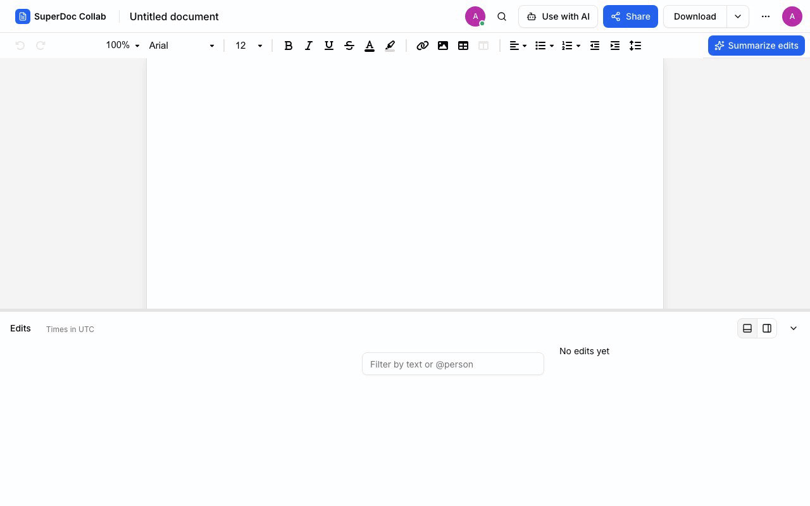

# SuperDoc Collab

A collaborative DOCX editor that records every edit and shows who changed what, and when: a timeline per topic, time travel to any moment, and model-written summaries of the edits you select. Built on SuperDoc for its take-home brief ([`docs/brief/`](docs/brief/superdoc-eng-sample-project.docx)).

**Live demo:** <https://superdoc.dhyegocalota.com.br>. Accounts are by invitation: sign in as `ana@example.com` with the password from the delivery message, and open a second browser as `bruno@example.com` to edit together.



An AI client connected through OAuth edits the document through MCP tools, as tracked changes the person can accept or reject. The timeline attributes its edits as the agent, a hatched layer with an AI mark beside the human bands, as the [agentic history spec](docs/features/agentic-history-mcp/spec.md) describes.

## What you can do

1. **Write together.** Open a Word document in the browser and edit it with other people at the same time, each with a cursor in their own colour.
2. **See how the document changed.** A chart beside the page shows how much was edited over time, one coloured band per subject that the AI names, such as "Pricing" or "Timeline". Hover any moment to see who was working on what.
3. **Go back to any moment.** Click a point in the chart to open the document exactly as it was then, read-only, with that moment's edits highlighted.
4. **Find who changed what.** Type a word to see every edit that touched it, or `@Ana` to see only Ana's edits; the chart and the list follow.
5. **Get a summary.** "Summarize edits with AI" writes a few sentences about the edits you are looking at, such as "Bruno rewrote the pricing section and Ana added two risks".
6. **Let an AI edit for you.** Connect your own AI assistant, such as Claude, ChatGPT or Cursor. It reads the history and edits as tracked changes you accept or reject, each marked as made by your AI, not by you.
7. **Share it.** Send an edit link or a read-only link, and remove anyone later.
8. **Start from a full example.** A new install opens on a sample document written over five days by four people, so the chart is full from the first click.

Also: upload by drag and drop, download as Word or PDF, dark mode, a phone layout, and accounts by invitation. How each feature works, and its limits: [Architecture, features and limits](docs/architecture.md#features).

## Quick install

**With an agent.** Paste this into Claude Code, Codex or any agent with a shell; it asks you one question, installs, and stops where only you can continue:

```text
Install https://github.com/dhyegocalota/superdoc-collab by following docs/agent-install.md in that repository.
```

**With Docker**, as a local demo with seeded users:

```bash
ENV_FILE=../.env.example APP_ORIGIN=http://localhost:3000 SEED_DEMO_USERS=true docker compose -f docker/docker-compose.local.yml up --build -d
```

Open <http://localhost:3000> and sign in as `ana@example.com` / `superdoc-demo`. The demo users are Ana, Bruno, Caio and Dani at `example.com`, all with that password. `docker compose -f docker/docker-compose.local.yml down -v` resets everything. Topics and summaries need `OPENROUTER_API_KEY`; without it the app works and the chart shows one band per author.

A sample document with five days of edits by four authors, "SuperDoc Collab: a guided tour", appears for the first admin who claims an instance, and Admin → Users has a Create the showcase document button to add another.

Railway, running from source, configuration and recovery: [Install and run](docs/install.md).

## Read more

- [Install and run](docs/install.md): Docker, Railway or an agent, then claim the instance and invite your team; [develop with an agent](docs/install.md#develop-with-an-agent)
- [Architecture, features and limits](docs/architecture.md)
- [Where it goes next](docs/next.md): how it scales, the integrations and the product ahead
- [Decisions](docs/adr/) and [features](docs/features/README.md#roadmap), one folder and one pull request each
- [Why there are no comments](docs/why-no-comments.md): where the why lives instead
- [How the work is done](.claude/HARNESS.md) with Claude Code, and the [credits](docs/credits.md)

## License

[GNU AGPL-3.0](LICENSE), the same licence as SuperDoc and its SDK. Copyright 2026 Dhyego Calota.
