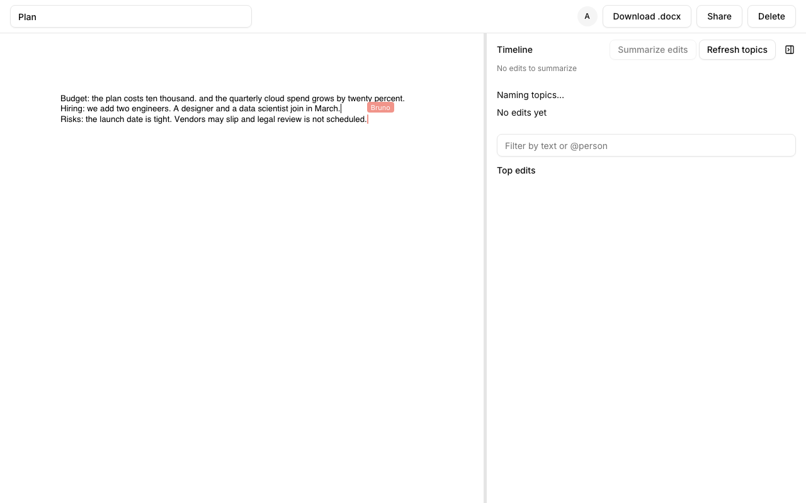
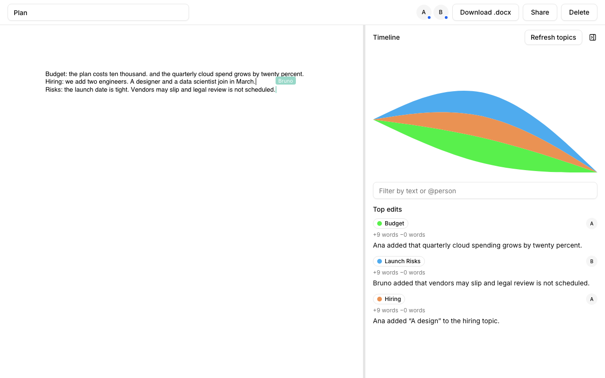
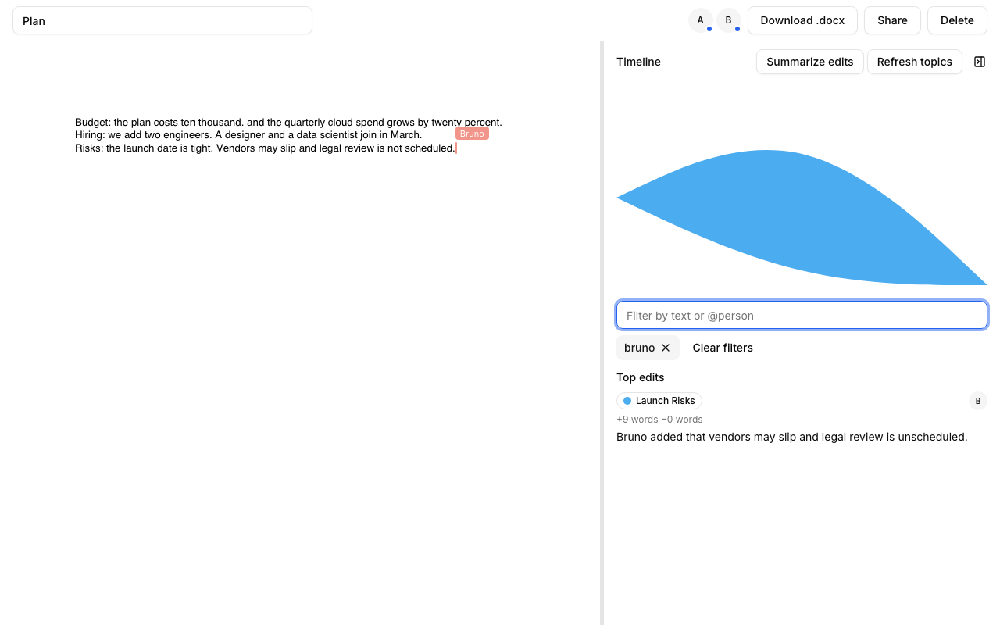
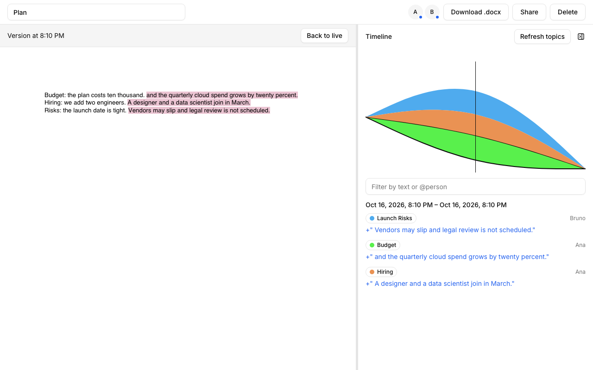
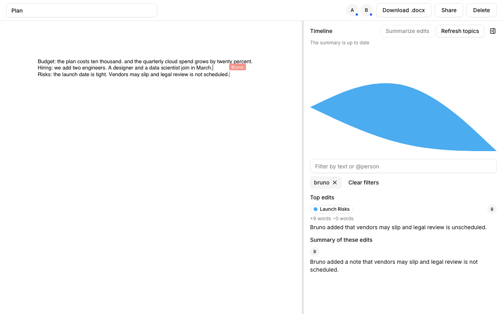
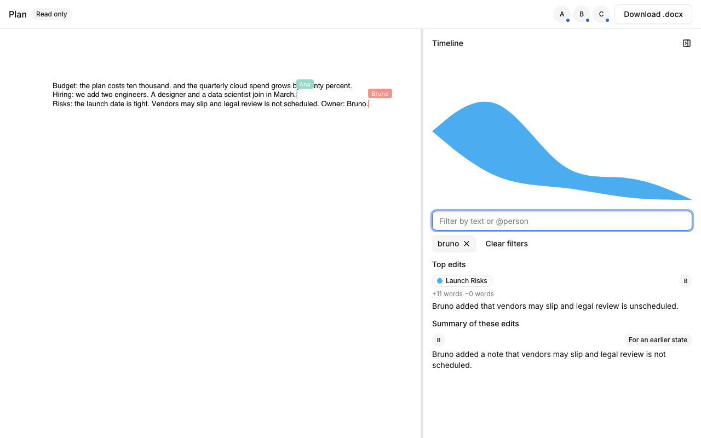
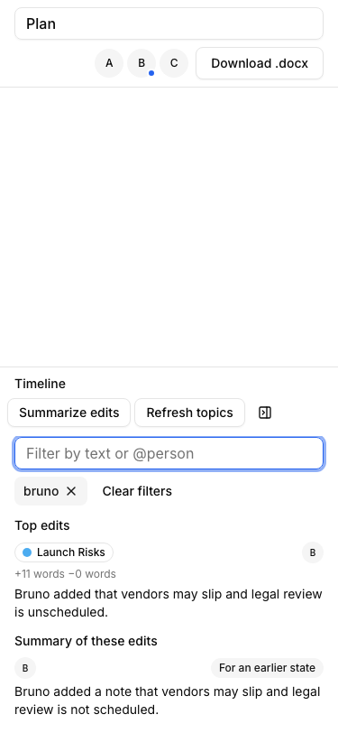

# SuperDoc History

A collaborative DOCX editor that records every edit and turns that record into a timeline of who changed what and when, with time travel and LLM-written summaries. It is the take-home project for SuperDoc ([brief](docs/brief/superdoc-eng-sample-project.docx)); the design rationale is in [`docs/adr/`](docs/adr/).

## Live demo

- **Demo:** <https://superdoc-history-production.up.railway.app> (Railway, [ADR 0019](docs/adr/0019-deploy-on-railway.md)).
- **Repository:** <https://github.com/dhyegocalota/superdoc-take-home>

The demo accounts' password comes with the delivery message. Every slice, its spec and its pull request are listed in the [roadmap](docs/features/README.md#roadmap).

## Try it

1. Sign in as `ana@example.com` with the demo password, or create your own account.
2. **Upload .docx** with your own file or with the brief ([`docs/brief/superdoc-eng-sample-project.docx`](docs/brief/superdoc-eng-sample-project.docx)); **New document** starts from a blank page.
3. Type a few sentences, delete a word, then **Share** and copy the edit link.
4. Open the link in a private window, sign in as `bruno@example.com` and edit next to Ana: each sees the other's edits and cursor.
5. **Toggle timeline**: the chart shows edit volume over time per topic (per author until topics exist), and **Top edits** lists who changed what.
6. Filter with plain text, or `@bruno` for one person: the chart, the list and the highlights narrow together.
7. Click a moment on the chart to read the document as it was then; **Back to live** returns.
8. **Summarize edits** writes one to three sentences about exactly the edits the panel shows.

## Screenshots

| | |
|---|---|
|  |  |
| Ana and Bruno edit the same document live, each seeing the other's cursor | The timeline panel: one band per topic, named by the model |
|  |  |
| Top edits: topic, word delta, contributors and one sentence about what changed | `@bruno` narrows the chart, the list and the highlights to one person |
|  |  |
| Time travel: the document as it was at that moment, its edits highlighted, with Back to live | Summarize edits: one to three sentences about exactly the selection on screen |
|  |  |
| A reader joined through the read-only link sees the summary but cannot type or summarize | At 375 px the panel stacks under the editor |

Each pull request also carries a video walk recorded with Playwright MCP, for example the [LLM insights walkthrough](https://github.com/dhyegocalota/superdoc-take-home/releases/download/pr-media-llm-insights/walkthrough.mp4); the full sets are embedded in the pull requests listed in the [roadmap](docs/features/README.md#roadmap).

## Features

- **Documents.** Upload a `.docx` (up to 10 MB) or create a blank document; the list shows "Mine" and "Shared with me" with the owner, the last update and your role. Rename, download and delete from the editor header (delete is owner only).
- **Live editing.** Documents open in SuperDoc with several people editing at once; members and who is online show in the header.
- **Sharing.** The owner gets an edit link and a read-only link, copies them from the Share dialog and can rotate either one. Anyone signed in who opens a link joins with that link's access; a rotation invalidates the link and keeps the members it already admitted. Readers see edits live but cannot type, and a reader can open a document only after the owner has opened it once.
- **History capture.** Every Yjs update is appended to a log with the connection's user, identities are bound to authors from SuperDoc's awareness, and a projection turns the log into edit events (who inserted or deleted what, in which block, when).
 `GET /api/documents/:id/events` serves them in pages of 500; tracked changes already in an uploaded file are imported with their original authors.
- **Timeline panel.** A streamgraph of edit volume over time, one band per topic (or per author while no topics exist), with labels inside the bands. Hover shows the band, the time bin and who contributed; the bin size follows the history span, from minutes up to days, and you can pin it with `?binMs=` on `GET /timeline`. The panel updates while people type: the projection runs on a 1.5 s throttle from every logged update.
- **Filter.** One box: plain text matches inserted or deleted text, case-insensitively; `@person` matches an author's name or email. Both narrow the chart, the list and the highlights, and the filter lives in the URL.
- **Top edits.** Per topic, sorted by volume: the contributors, `+N words -M words` and one LLM sentence about what the edits changed. A topic is summarized again only after it receives new edits, at most once a minute per document.
- **Time travel.** Click a moment, or scrub, to open the document as it was then: read-only, in a framed viewer with a "back to live" banner, with the edits of that moment highlighted. Versions are exact: a mark is kept per minute and per bootstrap, a request resolves to the nearest mark at or before it, and each version has its own read-only endpoint (`/collaboration/versions/<id>/<sequence>`) that never writes the log. `GET /api/documents/:id/versions?around=<sequence>` lists the marks around a sequence (`around` is required).
- **Topics.** Four to eight topics per document, named by the model once and recomputed when five or more new blocks land outside every topic (at most once a minute). Editors can refresh them from the panel; the refresh budget is one run per document every 30 seconds, and a second request inside it answers 429 with `Retry-After`.

Data lives under `DATABASE_DIR`: `auth.sqlite` (users, sessions, documents, members, share links, topics and summaries), `history.sqlite` (update log, snapshots, identities), `read-model.sqlite` (edit events, version marks and the projection cursor) and `documents/<id>.docx`. Documents projected before version marks existed are rebuilt at startup, and their versions answer 202 until then.

### Summarize edits

The timeline panel header has a **Summarize edits** button, shown to owners and editors; readers read an existing summary but cannot request one. It summarizes exactly what the panel shows: the text filter, `@person`, the highlighted topic and the selected period. The result is one to three sentences naming who edited and what changed, with an avatar for each author.

- **One call per selection and document state.** The summary is cached and shared with every member of the document. Asking again, or another member asking with the same selection, reads the cache instead of calling the model.
- **Cooldown.** A new model call is allowed once per document every 30 seconds. A request inside the cooldown is refused with 429 and `Retry-After`, and the panel shows "Try again in N s." until it ends.
- **Earlier state.** When edits arrive after a summary was written, the card keeps the sentence, shows a "For an earlier state" badge and re-enables the button.
- **Disabled with a reason.** The button explains itself when the selection has no edits, a summary is running or up to date, or no model is configured.
- **Process-wide caps.** At most `LLM_MAX_CONCURRENT_JOBS` jobs run at once and `LLM_MAX_CALLS_PER_HOUR` calls per rolling hour across all documents ([ADR 0011](docs/adr/0011-process-wide-llm-cost-caps.md)); beyond either the request answers 503 and consumes no cooldown. Caching is described in [ADR 0012](docs/adr/0012-selection-summaries-cached-per-filter-and-cursor.md).
- **Keyboard.** Focusing a band in the streamgraph shows the tooltip of the selected period, and the tooltip opens inward at the chart's edges.

### LLM configuration

Topics, the per-topic sentences and the selection summaries go through the Vercel AI SDK and OpenRouter. Set `LLM_MODEL` (`.env.example` uses `openai/gpt-6-luna`) and `OPENROUTER_API_KEY`; `OPENROUTER_BASE_URL` is optional and points the client at another compatible endpoint. `LLM_MAX_CONCURRENT_JOBS` (default 2) and `LLM_MAX_CALLS_PER_HOUR` (default 60) cap spend for the whole server. Without a key the app keeps working: the topics state becomes `failed` with the reason, and the chart shows one band per author. The prompts carry document text and author names only, never emails; each block is cut at 500 characters, markup in the text is escaped, a selection prompt never exceeds 6000 characters once escaped, and the prompts tell the model that block and edit content is data, not instructions. The test suite mocks the model; the one real call is a smoke test that is skipped without a key:

```bash
scripts/with-env.sh pnpm --filter @superdoc-history/server exec vitest run src/insights/topics-llm.smoke.test.ts
```

## Run locally

Requirements: Node 24 (`.nvmrc`) and pnpm 8.15.9.

```bash
cp .env.example .env
pnpm install
set -a; source .env; set +a
pnpm seed
pnpm dev
```

The server reads its configuration from the shell; there is no dotenv loader. Web runs on <http://localhost:5173> and proxies `/api` and `/collaboration` to the server on port 3000. Agents never edit `.env`.

The editor needs the built bundle: SuperDoc's worker breaks under `vite dev`. To use documents, run `pnpm build`, then start the server with `WEB_DIST_DIR=apps/web/dist` and open the server's own port.

Run any command with the variables from `.env` loaded without printing them: `scripts/with-env.sh pnpm dev` (or `ENV_FILE=.env.example scripts/with-env.sh …`). Agents never read or edit `.env`; this script is how they start the app with real secrets.

## Run with Docker

```bash
ENV_FILE=.env.example APP_ORIGIN=http://localhost:3000 SEED_DEMO_USERS=true docker compose up --build -d
curl -s -o /dev/null -w '%{http_code}' -H 'content-type: application/json' -H 'origin: http://localhost:3000' -d '{"email":"ana@example.com","password":"superdoc-demo"}' localhost:3000/api/auth/sign-in/email
```

The sign-in smoke check must print `200`.

One image serves the SPA and the API on <http://localhost:3000>; the healthcheck calls `/api/health`. Reset all data with `docker compose down -v`. The image carries both history migration sets (`libs/history/drizzle`) and `@superdoc/sdk`'s native binary, which imports tracked changes from uploads; the server creates `/data/documents` at boot. The entrypoint requires `SEED_DEMO_USERS` to be exactly `true` or `false`, and `DEMO_PASSWORD` when it is `true`.

## Deploy (Railway)

The demo runs on Railway as one service built from [`docker/Dockerfile`](docker/Dockerfile), with a volume at `/data`, one replica, the health check on `/api/health` and Railway's TLS domain ([ADR 0019](docs/adr/0019-deploy-on-railway.md)); [`railway.json`](railway.json) declares the builder and the health check. The environment is the one [`deploy/docker-compose.yml`](deploy/docker-compose.yml) documents for any compose host, with `TRUST_PROXY=true`, which is safe only behind a proxy. The [Railway runbook](docs/features/deploy/runbook-railway.md) creates the service, the volume and the variables, checks the deploy, seeds the demo accounts and rolls back. CI builds and boots the image on every pull request (job `docker` in [`verify.yml`](.github/workflows/verify.yml)).

## Demo users

Ana, Bruno, Caio and Dani: `ana@example.com`, `bruno@example.com`, `caio@example.com`, `dani@example.com`. Locally the password is `DEMO_PASSWORD` (`superdoc-demo` in `.env.example`); on the demo URL it is the one in the delivery message. `pnpm seed` and the container's entrypoint are idempotent: existing accounts keep their password.

## Tests

| Command | Covers |
|---|---|
| `pnpm typecheck` | every package plus the E2E project |
| `pnpm test:unit` | `libs/types`, `libs/history`, `apps/server` (real HTTP, real SQLite, real WebSocket; the 150 ms timeline latency budget is asserted only when `CI` is unset; the deploy checks in `apps/server/src/repository-shape` render the compose file with the Docker CLI and Compose v2, no daemon needed; that block is skipped without the Docker CLI and required in CI) and `apps/web` (Vitest and Testing Library) |
| `pnpm test:e2e` | Playwright specs for auth, documents and sharing, two-author collaboration, the timeline, time travel, topics and summaries; builds and starts the stack itself, needs Chromium (`pnpm exec playwright install chromium`) |
| `pnpm verify` | the three above, in order; the same gate runs in CI ([`verify.yml`](.github/workflows/verify.yml)) next to the `docker` job that builds and boots the image |

## Architecture in brief


One Node process on one port: Hono serves the API and the built SPA, and Hocuspocus serves the collaboration WebSocket. Better Auth stores users and sessions in SQLite through Drizzle and better-sqlite3. `libs/history` holds the update log, the projection and the read model; one worker thread projects the log into edit events. The web app is a React and Vite SPA. See [ADR 0001](docs/adr/0001-event-sourcing-over-yjs.md), [ADR 0004](docs/adr/0004-stack.md), [ADR 0005](docs/adr/0005-authentication-with-better-auth.md) and [ADR 0009](docs/adr/0009-design-system.md).

## Process

Work follows a written harness: agree on a spec, record decisions as ADRs, plan, build with developer sub-agents, prove with a separate tester sub-agent, review with a reviewer sub-agent, then ship.

- [`AGENTS.md`](AGENTS.md): facts and code conventions
- [`.claude/HARNESS.md`](.claude/HARNESS.md): the process
- [`docs/adr/`](docs/adr/): decisions and alternatives
- [`docs/features/`](docs/features/): spec, plan, test plan and tester briefing per feature
- [`docs/learnings/`](docs/learnings/): dated traps
- [`poc/`](poc/RESULTS.md): proof-of-concept results behind the history architecture

## Limits

- **One instance.** SQLite files, the projection worker and the language-model caps live in one process ([ADR 0004](docs/adr/0004-stack.md)). The app does not scale horizontally, and a restart forgets the in-memory cooldowns.
- **Language-model caps.** At most 2 model jobs at once and 60 model calls per rolling hour for the whole server ([ADR 0011](docs/adr/0011-process-wide-llm-cost-caps.md)). Past them topics show "The language model is busy; try again later." and a summary request gets a 503 that consumes no cooldown. A model error or a missing key shows "The topics could not be named. Try again." or "The edits could not be summarized. Try again." instead. Editing keeps working in every case.
- **No email.** Accounts have no verification and no password reset; the demo accounts share one password.
- **DOCX only.** Up to 10 MB per file; no PDF or image import.
- **Manual backups.** The [runbook](docs/features/deploy/runbook-railway.md#8-back-up-and-reset) shows how to copy the data volume.

## Credits

**LLM use.** This codebase is developed with Claude Code (Anthropic) driving the harness in this repository. Every pull request is built by developer sub-agents, tested by a separate tester sub-agent with Playwright MCP and reviewed by a reviewer sub-agent; decisions are recorded in ADRs. The product itself calls a model in three places: topic names for a document, one sentence per topic and the sentence for a selection of edits, through the Vercel AI SDK and OpenRouter with `openai/gpt-6-luna` ([ADR 0006](docs/adr/0006-llm-via-vercel-ai-sdk.md)). Only author names and edit text are sent (names only, no emails), capped at 500 characters per block and 6000 characters per selection prompt, and the prompts treat that text as data, not instructions; without a key the features degrade to a `failed` state instead of failing the page.

**Libraries.**

- SuperDoc editor `superdoc` and `@superdoc/sdk` (AGPL-3.0)
- Hocuspocus server and provider (MIT) and Yjs (MIT) for real-time collaboration
- Better Auth (MIT) for accounts and sessions
- Drizzle ORM (Apache-2.0) over better-sqlite3 (MIT)
- Hono (MIT) for the API
- React (MIT) and Vite (MIT) for the web app, with `d3-scale` and `d3-shape` (ISC) for the streamgraph
- Vercel AI SDK `ai` and the OpenRouter provider (Apache-2.0), calling `openai/gpt-6-luna` through OpenRouter

**Starter code.**

- shadcn/ui components (MIT) copied under `apps/web/src/components/ui`
- superpowers skills (MIT, version 6.4.1) vendored under `.agents/skills`
- Drizzle schema generated by the Better Auth CLI at `apps/server/src/database/schema/auth.ts`

## License

[GNU AGPL-3.0](LICENSE), the same licence as SuperDoc and its SDK, which this application is built on. Copyright 2026 Dhyego Calota.
