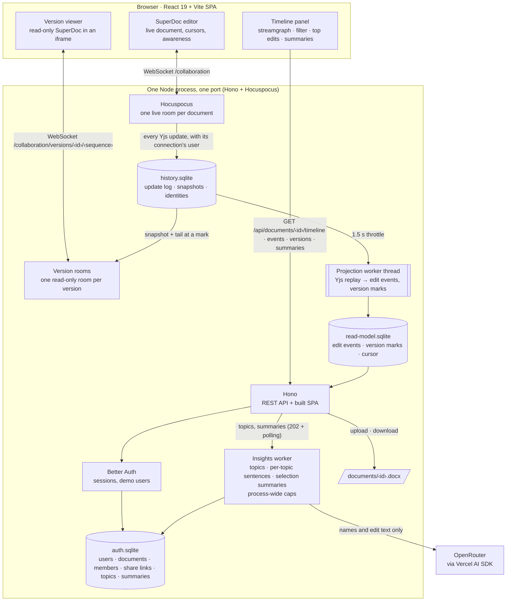

# Architecture, features and limits

The README stays short on purpose; this page holds what it used to say.

## Architecture in brief

One Node process on one port: Hono serves the API and the built SPA, and Hocuspocus serves the collaboration WebSocket. Better Auth stores users and sessions in SQLite through Drizzle and better-sqlite3. The history library holds the update log, the projection and the read model; one worker thread projects the log into edit events. The web app is a React and Vite SPA. See [ADR 0001](adr/0001-event-sourcing-over-yjs.md), [ADR 0004](adr/0004-stack.md), [ADR 0005](adr/0005-authentication-with-better-auth.md) and [ADR 0009](adr/0009-design-system.md).

Data lives under `DATABASE_DIR`: the auth database (users, sessions, documents, members, share links, topics and summaries), the history database (update log, snapshots, identities), the read model (edit events, version marks and the projection cursor) and the uploaded files. Documents projected before version marks existed are rebuilt at startup, and their versions answer 202 until then.

## Features

- **Documents.** Upload a `.docx` (up to 10 MB) or create a blank document; the list shows "Mine" and "Shared with me" with the owner, the last update and your role. Rename, download and delete from the editor header (delete is owner only).
- **Live editing.** Documents open in SuperDoc with several people editing at once; members and who is online show in the header.
- **Sharing.** The owner gets an edit link and a read-only link, copies them from the Share dialog and can rotate either one. Anyone signed in who opens a link joins with that link's access; a rotation invalidates the link and keeps the members it already admitted. Readers see edits live but cannot type, and a reader can open a document only after the owner has opened it once.
- **History capture.** Every Yjs update is appended to a log with the connection's user, identities are bound to authors from SuperDoc's awareness, and a projection turns the log into edit events (who inserted or deleted what, in which block, when). The events are served in pages of 500; tracked changes already in an uploaded file are imported with their original authors.
- **Timeline panel.** A streamgraph of edit volume over time, one band per topic (or per author while no topics exist), with labels inside the bands. Hover shows the band, the time bin and who contributed; the bin size follows the history span, from minutes up to days, and the timeline request accepts a pinned bin size. The panel updates while people type: the projection runs on a 1.5 s throttle from every logged update.
- **Filter.** One box: plain text matches inserted or deleted text, case-insensitively; `@person` matches an author's name or email. Both narrow the chart, the list and the highlights, and the filter lives in the URL.
- **Top edits.** Per topic, sorted by volume: the contributors, the word delta and one model sentence about what the edits changed. A topic is summarized again only after it receives new edits, at most once a minute per document.
- **Time travel.** Click a moment, or scrub, to open the document as it was then: read-only, in a framed viewer with a "back to live" banner, with the edits of that moment highlighted. Versions are exact: a mark is kept per minute and per bootstrap, a request resolves to the nearest mark at or before it, and each version has its own read-only room that never writes the log.
- **Topics.** Four to eight topics per document, named by the model once and recomputed when five or more new blocks land outside every topic (at most once a minute). Editors can refresh them from the panel; the refresh budget is one run per document every 30 seconds, and a second request inside it answers 429 with `Retry-After`.

### Summarize edits

The timeline panel header has a **Summarize edits** button, shown to owners and editors; readers read an existing summary but cannot request one. It summarizes exactly what the panel shows: the text filter, `@person`, the highlighted topic and the selected period. The result is one to three sentences naming who edited and what changed, with an avatar for each author.

- **One call per selection and document state.** The summary is cached and shared with every member of the document. Asking again, or another member asking with the same selection, reads the cache instead of calling the model.
- **Cooldown.** A new model call is allowed once per document every 30 seconds. A request inside the cooldown is refused with 429 and `Retry-After`, and the panel shows "Try again in N s." until it ends.
- **Earlier state.** When edits arrive after a summary was written, the card keeps the sentence, shows a "For an earlier state" badge and re-enables the button.
- **Disabled with a reason.** The button explains itself when the selection has no edits, a summary is running or up to date, or no model is configured.
- **Process-wide caps.** At most `LLM_MAX_CONCURRENT_JOBS` jobs run at once and `LLM_MAX_CALLS_PER_HOUR` calls per rolling hour across all documents ([ADR 0011](adr/0011-process-wide-llm-cost-caps.md)); beyond either the request answers 503 and consumes no cooldown. Caching is described in [ADR 0012](adr/0012-selection-summaries-cached-per-filter-and-cursor.md).
- **Keyboard.** Focusing a band in the streamgraph shows the tooltip of the selected period, and the tooltip opens inward at the chart's edges.

### Language model

Topics, the per-topic sentences and the selection summaries go through the Vercel AI SDK and OpenRouter ([ADR 0006](adr/0006-llm-via-vercel-ai-sdk.md)). Set `LLM_MODEL` and `OPENROUTER_API_KEY`; `OPENROUTER_BASE_URL` is optional and points the client at another compatible endpoint. `LLM_MAX_CONCURRENT_JOBS` (default 2) and `LLM_MAX_CALLS_PER_HOUR` (default 60) cap spend for the whole server. Without a key the app keeps working: the topics state becomes `failed` with the reason, and the chart shows one band per author. The prompts carry document text and author names only, never emails; each block is cut at 500 characters, markup in the text is escaped, a selection prompt never exceeds 6000 characters once escaped, and the prompts tell the model that block and edit content is data, not instructions. The test suite mocks the model; the one real call is a smoke test that is skipped without a key.

## Tests

| Command | Covers |
|---|---|
| `pnpm typecheck` | every package plus the E2E project |
| `pnpm test:unit` | the shared types, the history library, the server (real HTTP, real SQLite, real WebSocket; the repository-shape checks render the compose file with the Docker CLI, verify every README's relative links and that every package has a README) and the web app (Vitest and Testing Library) |
| `pnpm test:e2e` | Playwright specs for auth, documents and sharing, two-author collaboration, the timeline, time travel, topics and summaries; builds and starts the stack itself, needs Chromium (`pnpm exec playwright install chromium`) |
| `pnpm verify` | the three above, in order; the same gate runs in CI next to the job that builds and boots the Docker image |

## Deploy

The demo runs on Railway as one service built from the Dockerfile, with a volume for the data, one replica, the health check on the health endpoint and Railway's TLS domain ([ADR 0019](adr/0019-deploy-on-railway.md)). The environment is the one the compose file documents for any compose host, with `TRUST_PROXY=true`, which is safe only behind a proxy. The [Railway runbook](features/deploy/runbook-railway.md) creates the service, the volume and the variables, checks the deploy, seeds the demo accounts and rolls back. CI builds and boots the image on every pull request.

## Limits

- **One instance.** SQLite files, the projection worker and the language-model caps live in one process ([ADR 0004](adr/0004-stack.md)). The app does not scale horizontally, and a restart forgets the in-memory cooldowns; [Where it goes next](next.md#scale) lists the steps that lift this.
- **Language-model caps.** At most 2 model jobs at once and 60 model calls per rolling hour for the whole server ([ADR 0011](adr/0011-process-wide-llm-cost-caps.md)). Past them topics show "The language model is busy; try again later." and a summary request gets a 503 that consumes no cooldown. A model error or a missing key shows "The topics could not be named. Try again." or "The edits could not be summarized. Try again." instead. Editing keeps working in every case.
- **No email.** Accounts have no verification and no password reset; the demo accounts share one password.
- **DOCX only.** Up to 10 MB per file; no PDF or image import.
- **Manual backups.** The [runbook](features/deploy/runbook-railway.md#8-back-up-and-reset) shows how to copy the data volume.
