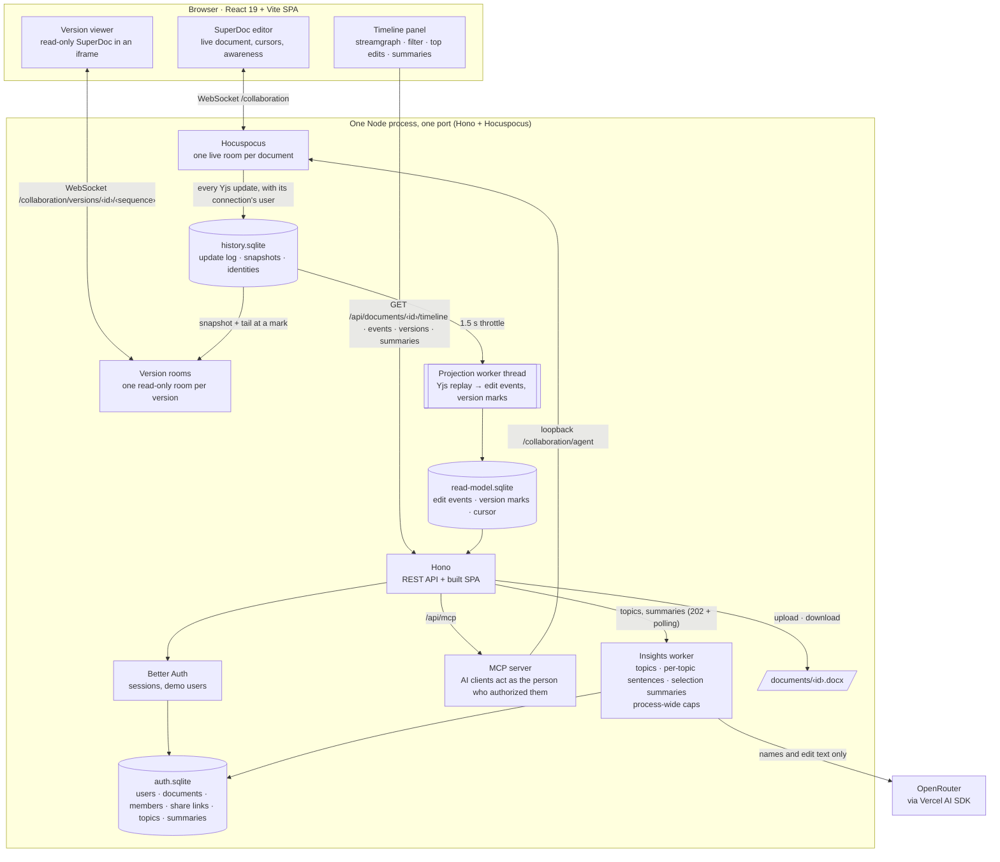

# Architecture, features and limits

The README stays short on purpose; this page holds what it used to say.

## Architecture in brief

One Node process on one port: Hono serves the API, the MCP endpoint and the built SPA, and Hocuspocus serves the collaboration WebSocket. Better Auth stores users and sessions in SQLite through Drizzle and better-sqlite3. The history library holds the update log, the projection and the read model; one worker thread projects the log into edit events. The web app is a React and Vite SPA. See [ADR 0001](adr/0001-event-sourcing-over-yjs.md), [ADR 0004](adr/0004-stack.md), [ADR 0005](adr/0005-authentication-with-better-auth.md), [ADR 0009](adr/0009-design-system.md) and [ADR 0025](adr/0025-mcp-clients-authorize-with-oauth-and-join-rooms-by-room-token.md).

Data lives under `DATABASE_DIR`: the auth database (users, sessions, invites, documents, members, share links, topics and summaries), the history database (update log, snapshots, identities), the read model (edit events, version marks and the projection cursor) and the uploaded files. Documents projected before version marks existed are rebuilt at startup, and their versions answer 202 until then.

## Features

- **Accounts.** Sign-up is by invitation: the first account claims the instance as administrator and every later one needs a single-use invite from the admin page that expires after 7 days. The app sends no email, so an administrator creates a password reset link for any user from the users table; the link works once, expires after an hour, opens a public page where the person chooses a new password, and ends the user's other sessions ([ADR 0020](adr/0020-invite-only-accounts-with-a-first-claim-admin.md)).
- **Showcase document.** The first administrator to claim an instance finds "SuperDoc Collab: a guided tour", a document whose imported tracked changes span five days and four authors, so the first timeline is full. Admin → Users has a button that creates another one for instances claimed earlier.
- **Documents.** Upload a `.docx` (up to 10 MB) or create a blank document; the list shows "Mine" and "Shared with me" with the owner, the last update and your role. An empty list shows a drop zone and a New document button, and a `.docx` dropped anywhere on the page uploads. Rename, download and delete from the editor header (delete is owner only). While the title is being edited, Save and Cancel sit beside the input as well as Enter and Escape. Download offers DOCX and PDF; the PDF prints from a same-origin frame that lays out every page, blank ones included ([ADR 0035](adr/0035-the-pdf-prints-from-a-same-origin-frame-with-its-own-viewport.md)).
- **Live editing.** Documents open in SuperDoc with several people editing at once, and an editor's caret is placed at the start of the document when it opens, for the creator and for people who join later. The header shows the members who are online now; a member who left drops out of the row.
- **Leaving with unsynced edits.** Edits made while the connection was lost, or a title still being edited, count as unsynced. Closing the tab shows the browser's own prompt. Navigating away or signing out opens a dialog with Stay, Download and Leave, and recovering the connection closes it.
- **Sharing.** The owner gets an edit link and a read-only link, copies them from the Share dialog and can rotate either one. Anyone signed in who opens a link joins with that link's access; a rotation invalidates the link and keeps the members it already admitted. The dialog lists everyone with access, and the owner removes any member but themself: the person's sockets close at once, their next poll shows the unavailable state and the document leaves their list. Readers see edits live but cannot type, and a reader can open a document only after an owner or editor has opened it once.
- **AI clients.** A remote MCP server at `/api/mcp` lets an AI client that a person authorizes through OAuth read the history, edit in tracked mode, export and share as that person. Its edits are signed "Name · AI" and form a hatched layer in the timeline, and the person revokes the client under Settings → Connected apps ([ADR 0025](adr/0025-mcp-clients-authorize-with-oauth-and-join-rooms-by-room-token.md)).
- **About.** A public page at `/about` names the author, the source, the licence and the credits, and is linked from the account menu. The page shell carries the description, Open Graph and Twitter tags, the icons, a web manifest and JSON-LD metadata, and `robots.txt` keeps the app's private paths out of search.
- **History capture.** Every Yjs update is appended to a log with the connection's user, identities are bound to authors from SuperDoc's awareness, and a projection turns the log into edit events (who inserted or deleted what, in which block, when). The events are served in pages of 500; tracked changes and comments already in an uploaded file are imported with their original authors and dates; a comment shows in the bin's edit list as a comment.
- **Timeline panel.** A streamgraph of edit volume over time, one band per topic (or per author while no topics exist), with labels inside the bands. Hover shows the band, the time bin and who contributed; the bin size follows the history span, from ten seconds up to a week, and the timeline request accepts a pinned bin size. The panel updates while people type: the projection runs on a 1.5 s throttle from every logged update.
- **Filter.** One box: plain text matches inserted or deleted text, case-insensitively; `@person` matches an author's name or email. Both narrow the chart, the list and the highlights, and the filter lives in the URL.
- **Top edits.** Per topic, sorted by volume: the contributors, the word delta and one model sentence about what the edits changed. A topic's sentence is rewritten only when it is older than the topic set it was written for, by the Summarize job below.
- **Time travel.** Click a moment, or scrub, to open the document as it was then: read-only, in a framed viewer with a "back to live" banner, with the edits of that moment highlighted. A mark is kept per minute and per bootstrap, and a bin opens the mark of its last instant. A sequence the log knows resolves exactly, so each edit row has a "View version after this edit" button that opens the document right after that edit even when a later edit in the same minute deleted it; an unknown sequence resolves to the nearest mark at or before it ([ADR 0043](adr/0043-a-known-version-sequence-resolves-exactly-and-marks-anchor-the-timeline.md)). Each version has its own read-only room that never writes the log.
- **Topics.** Four to eight topics per document, named by the model once and recomputed when five or more new blocks land outside every topic (at most once a minute). Summarize edits regroups them on demand when new edits have arrived since the last grouping ([ADR 0031](adr/0031-one-summarize-job-runs-only-what-is-stale.md)).

### Summarize edits

The timeline panel header has a **Summarize edits** button, shown to owners and editors; readers read an existing summary but cannot request one. It summarizes exactly what the panel shows: the text filter, `@person`, the highlighted topic and the selected period. The result is one to three sentences naming who edited and what changed, with an avatar for each author. One job runs only the steps that are stale, in order: regroup the topics, summarize the selection, rewrite the topic sentences; a click on fresh work makes no model call ([ADR 0031](adr/0031-one-summarize-job-runs-only-what-is-stale.md)).

- **One call per selection and document state.** The summary is cached and shared with every member of the document. Asking again, or another member asking with the same selection, reads the cache instead of calling the model.
- **Cooldown.** A new model call is allowed once per document every 30 seconds. A request inside the cooldown is refused with 429 and `Retry-After`, and the panel shows "Try again in N s." until it ends.
- **Earlier state.** When edits arrive after a summary was written, the card keeps the sentence, shows a "For an earlier state" badge and re-enables the button.
- **Disabled with a reason.** The button explains itself when the selection has no edits, a summary is running or up to date, or no model is configured.
- **Process-wide caps.** At most `LLM_MAX_CONCURRENT_JOBS` jobs run at once and `LLM_MAX_CALLS_PER_HOUR` calls per rolling hour across all documents ([ADR 0011](adr/0011-process-wide-llm-cost-caps.md)); beyond either the request answers 429 with the seconds until a slot frees and consumes no cooldown. Without a configured model the request answers 503 with the reason. Caching is described in [ADR 0012](adr/0012-selection-summaries-cached-per-filter-and-cursor.md).
- **Keyboard.** Focusing a band in the streamgraph shows the tooltip of the selected period, and the tooltip opens inward at the chart's edges.

### Language model

Topics, the per-topic sentences and the selection summaries go through the Vercel AI SDK and OpenRouter ([ADR 0006](adr/0006-llm-via-vercel-ai-sdk.md)). Set `LLM_MODEL` and `OPENROUTER_API_KEY`; `OPENROUTER_BASE_URL` is optional and points the client at another compatible endpoint. `LLM_MAX_CONCURRENT_JOBS` (default 2) and `LLM_MAX_CALLS_PER_HOUR` (default 60) cap spend for the whole server. Without a key the app keeps working: the topics state becomes `failed` with the reason, and the chart shows one band per author. The prompts carry document text and author names only, never emails; each block is cut at 500 characters, markup in the text is escaped, a selection prompt never exceeds 6000 characters once escaped, and the prompts tell the model that block and edit content is data, not instructions. The test suite mocks the model; the one real call is a smoke test that is skipped without a key.

## Conventions

The code has no comments: names carry the meaning, an ADR holds the reason, and a one-line `NB ADR` pointer links the two. [Why there are no comments](why-no-comments.md) states the rule and what it costs; the rest of the conventions are in [`AGENTS.md`](../AGENTS.md).

## Tests

| Command | Covers |
|---|---|
| `pnpm typecheck` | every package, `tools/repository-shape` included, plus the E2E project |
| `pnpm test:unit` | `libs/types`, `libs/history`, `apps/server` (real HTTP, real SQLite, real WebSocket), `apps/web` (Vitest and Testing Library) and `tools/repository-shape`, then the hook tests and the gate's own tests |
| `pnpm --filter @superdoc-collab/repository-shape test:unit` | the repository itself: the README quick install and the install guide's run-from-source block pinned to `package.json`, `.env.example`, the workspace and the demo users; every README's relative links and that every package has one; the compose files rendered with the Docker CLI; the Dockerfile, the entrypoint and the workflows; feature statuses against the index; the scenarios and the agent surfaces |
| `pnpm test:e2e` | Playwright specs for auth and admin (invites, password reset, showcase), documents and sharing (revoke access), two-author collaboration and the caret on open, the connection state and the exit confirmation, room admission, the timeline, idle breaks, time travel, topics and summaries, the About page, the AI client through OAuth, settings and the dark theme; builds and starts the stack itself with a fake model server, needs Chromium (`pnpm exec playwright install chromium`) |
| `pnpm verify` | the local gate: it runs the gates the diff can break (doctor, format, secrets, typecheck, audit, hooks, shape, unit, e2e, docker) once per commit ([ADR 0030](adr/0030-the-local-gate-runs-what-the-diff-can-break.md)); the shape gate runs on every class of change |

## Deploy

The demo runs on Railway as one service built from `docker/Dockerfile`, with a volume for the data, one replica, the health check on the health endpoint and Railway's TLS domain ([ADR 0019](adr/0019-deploy-on-railway.md)). `docker/docker-compose.yml` documents the same environment for any compose host, and `docker/docker-compose.local.yml` runs the app on one machine. Production sets `TRUST_PROXY=true`, which is safe only behind a proxy: the client address is the entry the trusted proxy added to `X-Forwarded-For`, counted from the right by `TRUSTED_PROXY_HOPS` (default 1, which is Railway alone), so a client-chosen entry is never read ([ADR 0042](adr/0042-the-client-address-is-the-rightmost-trusted-hop.md)). The [Railway runbook](features/deploy/runbook-railway.md) creates the service, the volume and the variables, checks the deploy, claims the instance and rolls back. The `docker` gate of `pnpm verify` builds the image when its own files change, and the verify workflow also boots it on pull requests when hosted runs are available.

## Limits

- **One instance.** SQLite files, the projection worker and the language-model caps live in one process ([ADR 0004](adr/0004-stack.md)). The app does not scale horizontally, and a restart forgets the in-memory cooldowns; [Where it goes next](next.md#scale) lists the steps that lift this.
- **Language-model caps.** At most 2 model jobs at once and 60 model calls per rolling hour for the whole server ([ADR 0011](adr/0011-process-wide-llm-cost-caps.md)). Past them topics show "The language model is busy; try again later." and a summary request gets a 429 with `Retry-After` that consumes no cooldown. A model error or a missing key shows "The topics could not be named. Try again." or "The edits could not be summarized. Try again." instead. Editing keeps working in every case.
- **No email.** Accounts have no verification and the app sends no mail: invites and password resets are links an administrator copies and hands over, and a person who forgot their password needs an administrator. The seeded demo accounts, used by tests and local runs only, share one password.
- **Per-address limits.** The authentication rate limit is keyed by client address, so `TRUST_PROXY=true` is set only when every request arrives through the trusted proxy. Opening a document for the first time is budgeted per user (30 a minute by default), and the collaboration socket closes a connection that floods it with frames ([ADR 0034](adr/0034-collaboration-socket-payload-and-rate-limits.md), [ADR 0040](adr/0040-the-socket-frame-cap-allows-fast-typing-and-reconnect-bursts.md)).
- **DOCX only.** Up to 10 MB per file; no PDF or image import. PDF is an export that goes through the browser's print dialog.
- **No role change in place.** A member's role changes by removing them and sharing again; removing a person does not stop them from accepting the same link, which the owner rotates to prevent.
- **Manual backups.** The [runbook](features/deploy/runbook-railway.md#8-back-up-and-reset) shows how to copy the data volume.
