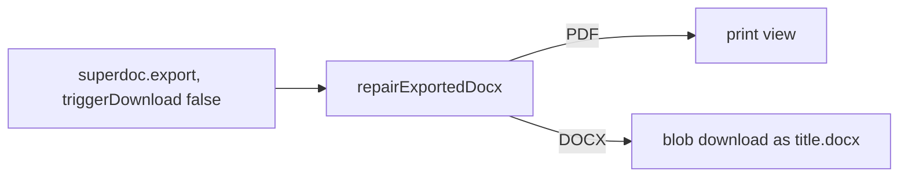

# Export namespace repair

**Status:** Building
**Tier:** 🟡
**Owner approval:** approved 2026-10-21 (owner's requirement 40, translated: "Download PDF" fails in production on documents with tracked changes from Word)
**ADRs:** none
**Not changing:** the print view, the PDF page counting, SuperDoc itself, the stored upload

## Problem

"Download PDF" shows "The PDF could not be prepared." on a document that carries tracked changes from Word. Proven in production with the Playwright MCP:

- `superdoc.export({ triggerDownload: false })` (SuperDoc 2.23.0) returns a DOCX whose `word/document.xml` uses the `w16du` prefix (`<w:ins w:id="0" w:author="…" w:date="…" w16du:dateUtc="…">`, kept from the uploaded Word file).
- The export declares only 23 namespaces on `<w:document>` and drops `xmlns:w16du="http://schemas.microsoft.com/office/word/2023/wordml/word16du"`. The stored upload declares 35, including it.
- The result is not well-formed XML ("unbound prefix"). The print page's viewing-mode SuperDoc fails in 150 ms (`reason: open-failed`), `onException` fires and the toast says the PDF could not be prepared.
- Swapping only `word/document.xml` of the stored file with the export's reproduces it. The same export with the image removed still fails. Documents without such attributes (the brief, a comments-only probe) print fine.
- `Download .docx` hands out the same malformed file.

## Goals

- Every export the app uses (the PDF print view and the DOCX download) is well-formed XML in every `word/` part.
- A prefix the export uses but did not declare is declared again with the namespace Word uses.

## Non-goals

- Fixing SuperDoc. An issue draft is below.
- Repairing anything but missing namespace declarations.
- Repairing parts outside `word/` or the stored upload.

## Design

### Data flow

### Interfaces

`repairExportedDocx(exported: Blob): Promise<Blob>` in `apps/web/src/features/editor/repair-exported-docx.ts`.

The repair rule, for every `word/**/*.xml` part:

1. Collect the prefixes used by element names and attribute names, ignoring text and attribute values, `xml` and `xmlns`.
2. Keep the ones the root element does not declare and no inner element declares either.
3. Declare each on the root from `OOXML_NAMESPACES` (`ooxml-namespaces.ts`: the namespaces Word emits).
4. A part with nothing missing is written back unchanged.

The result keeps the type of the input and is compressed.

`downloadBlob({ blob, fileName })` in `apps/web/src/lib/download-blob.ts` saves the repaired DOCX as `<title>.docx`, because SuperDoc's own download cannot take a repaired file.

### Failure handling

An undeclared prefix that is not in the map throws, naming the part and the prefix. Nothing is dropped silently. For the PDF the existing failure toast shows. For the DOCX the existing export-failed alert shows.

## Open questions → answers

| Question | Options | Owner's answer | Date |
|----------|---------|----------------|------|
| Repair on the client or on stored uploads? | Client repair of the export; rewrite the upload | Client repair of the export, per the requirement | 2026-10-21 |

## SuperDoc issue draft

Title: `export()` drops namespace declarations it does not know but keeps the attributes that use them

Body: Opening a DOCX saved by Word whose `<w:ins>` carries `w16du:dateUtc` and calling `export({ triggerDownload: false })` returns a package whose `word/document.xml` still contains `w16du:dateUtc="…"` while `<w:document>` declares 23 namespaces instead of the original 35. `xmlns:w16du="http://schemas.microsoft.com/office/word/2023/wordml/word16du"` is missing, so the part is not well-formed ("unbound prefix") and SuperDoc cannot reopen its own export. Expected: the export keeps every namespace declaration of the source root, or drops the attributes whose namespace it drops. Version 2.23.0.

## Test strategy summary

Unit: the repair on a part with a missing declaration, an already well-formed export, an inner declaration, prefixes inside values, an unknown prefix, parts outside `word/`; the download menu hands the print view the repaired file; the page saves the repaired DOCX. E2E: a seeded DOCX with a tracked insertion carrying `w16du:dateUtc` downloads a well-formed DOCX and prints once.
