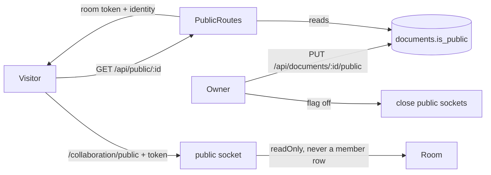

# Public read-only link

**Status:** Shipped 2026-10-21
**Tier:** 🔴
**Owner approval:** approved 2026-10-21
**ADRs:** [0050](../../adr/0050-anonymous-read-access-through-a-public-link.md), [0010](../../adr/0010-documents-ownership-and-share-links.md), [0017](../../adr/0017-share-links-reissued-when-the-secret-changes.md), [0025](../../adr/0025-mcp-clients-authorize-with-oauth-and-join-rooms-by-room-token.md), [0041](../../adr/0041-the-summary-card-shows-the-sentence-as-it-is-written.md), [0044](../../adr/0044-version-builds-are-budgeted-per-user-and-capped-in-the-projection-queue.md)
**Not changing:** the member and agent sockets, share links and their roles, the Summarize job and its budgets, the timeline, versions, comments and download routes (all keep their session guard), the update log and the projection.

## Problem

Showing a document to someone without an account means creating an account or sharing a login. The owner asked for the Google Docs "Anyone with the link can view": read-only, live, with the presence people know from Google, and with nothing a visitor can do to the document or to the model budget.

## Goals

- A switch in the Share dialog, `Anyone with the link can view`, owner only, off by default, with a button that copies the public link.
- `/public/<documentId>` opens the Reader view of the document without a session: live text, the `View only` chip, the latest stored summary when one exists, and the members row.
- Identity as Google does it: an anonymous visitor is `Anonymous <Animal>` with a colour slot and an animal avatar, issued by the server per visit; a signed-in non-member shows their real name and avatar. Both are read-only.
- Presence both ways: members see the visitors in the members row; the visitor sees the online people and the editors' live cursors. A visitor has no caret of their own.
- Nothing public can do anything: public HTTP is a GET allowlist; the public socket never writes.

## Non-goals

- Comments, download, history, versions, Summarize or any model work for visitors; a per-link expiry; a password; indexing by search engines.
- Making the id secret beyond its randomness: the document id is a random UUID (`randomUUID`, 122 bits, verified in `store-document.ts`), so it is the unguessable public slug and no second secret is stored.

## Design

### Data flow

1. The owner switches the flag (`PUT /api/documents/:documentId/public`, body `{ isPublic }`, owner only). Switching it off closes every open public socket of the document with the access-revoked close code.
2. A visitor opens `/public/:documentId`, which sits outside `RequireSession`. The page calls `GET /api/public/:documentId`. A document that does not exist and a document whose flag is off answer the same 404 body, so ids cannot be enumerated. A signed-in member gets `{ access: member }` and the page redirects to `/documents/:documentId`. Anyone else gets `{ access: visitor, document, viewer, roomToken }`: the viewer is `Anonymous <Animal>` (animal and colour from a fresh visitor id) or, for a signed-in non-member, their real name. The call spends no per-user open budget.
3. The page opens the socket `/collaboration/public?tab=` with the room token as the Hocuspocus token. The server checks the Origin, the per-address admission window, the token (its own key label, bound to the document, five minutes) and the flag again, then admits it with `connection.readOnly = true`, a synthetic visitor id (`public:<visitorId>`) and no `document_members` row. The room must already be committed (no uncommitted room is opened for a visitor) and the heavy room admission applies.
4. Updates from a public socket are refused by the read-only flag; `onChange` refuses again for a visitor context and appends nothing. Awareness frames from a visitor are silenced, so a visitor has no caret.
5. `GET /api/public/:documentId/summary` returns the most recently stored selection summary of the document (any filter key) with its date, or `null`. It reads one row; it computes nothing.

6. What a visitor receives and may send (security review of 2026-10-21): the awareness frames the server relays to a public socket are rewritten on the way out and keep only what a caret needs, by allowlist at any depth: `displayName`, `color`, `selection`, `connectionId`, the cursor extension `superdocV2CursorUi` and a few state fields (anything else, including `extensions.email`, is dropped); the `email` of every member never reaches a visitor, and the user `id` and `userId` are replaced by a 16-hex SHA-256 pseudonym (SuperDoc keys a remote caret by them, the visitor needs them distinct, not real). The browser keeps sending them in its own awareness, because SuperDoc takes the author's email from the same `user` object. A public socket may send only Sync, Awareness, QueryAwareness and Close messages, and at most two sync step 1 messages (the provider sends one; a step 1 makes the server encode the whole document) and one sync message other than step 1 (Hocuspocus runs `Y.snapshot` over the whole document for each one on a read-only connection); anything else (a stateless or broadcast stateless message above all) closes it with 1008 and `PUBLIC_MESSAGE_REASON`, and a public upgrade is cut at `PUBLIC_MAX_SOCKET_MESSAGE_BYTES` (1 MiB), because a visitor sends only a state vector. The per-address windows hold at most `KEYED_WINDOW_MAX_KEYS` addresses (least recently used first) and key an IPv6 address by its /64.

7. Residual risk and known limits: a visitor syncs the whole Y.Doc, so comments, tracked changes and authors that already carry a name or an email (imported with the DOCX, or written before this change) are visible to anyone with the link; the browser no longer passes `email` to SuperDoc, so nothing new carries one, and the Share dialog says what stays visible. The awareness pseudonym is an HMAC of the room and the user id keyed by the auth secret, so one person is not linked across public documents. The per-address windows key IPv6 by /64, so an attacker holding a /48 still has 65,536 windows: accepted.

### Interfaces

- `documents.is_public` integer boolean, not null, default 0 (migration 0009).
- `GET|PUT /api/documents/:documentId/public` (owner): `{ isPublic: boolean }`.
- `ApiPath.Public = /api/public`; `GET /api/public/:documentId`, `GET /api/public/:documentId/summary` and `GET /api/public/:documentId/members`. Every other method and path under it answers 404.
- `AppRoute.Public = /public/:documentId`; `ApiPath.PublicCollaboration = /collaboration/public`.
- `libs/types`: `PublicAnimal` enum, `anonymousViewerOf`, `signedInViewerOf`, `publicUserIdOf`, `PublicAccess`, `PublicOpened`, `PublicDocument`, `PublicViewer`, `PublicSummary`, `LatestSummary`; constants `PUBLIC_READS_PER_MINUTE`, `PUBLIC_SOCKET_ADMISSIONS_PER_MINUTE`, `PUBLIC_SUMMARY_REFRESH_MS`.
- Server: `signPublicRoomToken` and `verifyPublicRoomToken` (the generic `sealClaims` and `openClaims` of `room-tokens.ts`, their own key label); `authenticatePublic`; `InsightsRepository.latestSelectionSummary(documentId)`; `PublicConnections.close(documentId)`; `CollaborationContext.visitor`.
- Web: `features/sharing/public-page.tsx`, `public-api.ts`, `public-copy.ts`, `public-link-section.tsx` (the switch, inside `share-dialog.tsx`); `SuperDocEditor` takes an optional socket path and token.

### Failure handling

| Failure | Answer |
|---------|--------|
| Document missing, or flag off | 404 `Not found`, identical body for both |
| Window spent (GET or socket upgrade) | 429 with `Retry-After`; the upgrade answers an HTTP 429 and closes |
| Room not committed yet | 503 with `Retry-After`; the page shows the preparing copy and retries |
| Token expired, wrong document, replayed agent or bootstrap token, flag turned off since | the socket is destroyed before upgrade or closed with the unauthorized code; the page shows the connection failure banner with Reload, which fetches a fresh token |
| Flag turned off while viewing | open public sockets close; the page lands on the not-found state |
| No stored summary | the card is not rendered |
| Visitor sends an update | dropped, nothing applied, nothing logged |

### Rollback

Turn the flag off per document (the kill switch, closes sockets at once). Reverting the change leaves the `is_public` column unused: a revert of the code needs no data repair, and a revert of the migration loses only the flag.

## Open questions → answers

| Question | Options | Owner's answer | Date |
|----------|---------|----------------|------|
| What can the public do | Read only / read and summarize | "nobody public can do anything in the doc, like asking summarize edits; simply use the latest summarize edits available" | 2026-10-21 |
| What do visitors and members see of each other | A (invisible and blind) / B (anonymous counter) / C (Google link sharing) | "I want the Google Docs look-and-feel": C | 2026-10-21 |
| Is the document id guessable | UUID v4 / a separate slug | Not guessable (`randomUUID`); the id is the slug | 2026-10-21 |

## Test strategy summary

Vitest beside the routes and services: the repository and owner routes, the identity, the room token, the latest-summary query, the public routes (allowlist, 404 sameness, rate limit, no open budget, no emails, no `topics.ensure`), and the public socket (a Yjs update from a public connection is never applied nor logged, the flag off disconnects, awareness silenced). Component tests for the Share dialog switch and the public page. Playwright specs for owner toggles, anonymous reads live and cannot type. A Playwright MCP walk with two browsers: owner and anonymous. See [test-plan.md](test-plan.md).
