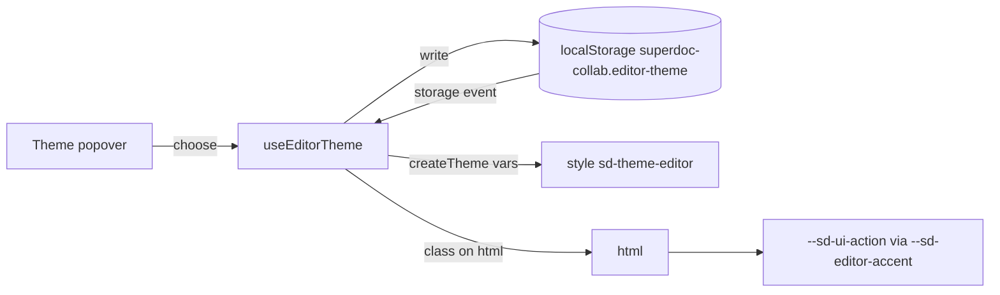

# Toolbar: ruler, document mode and theme

**Status:** Building
**Tier:** 🟡
**Owner approval:** approved 2026-10-21
**ADRs:** none
**Not changing:** the Reader experience (Viewing, no toolbar row), the app's own light/dark preference (`superdoc-collab.theme`), the measurement-unit item (stays hidden), the Summarize button, every other toolbar item.

## Problem

The editor toolbar hides three things SuperDoc ships or documents: the ruler, the document-mode switch (Editing, Suggesting, Viewing) and a way to colour the editor like the "Try a theme" widget on docs.superdoc.dev. The owner asked for all three in the toolbar (2026-10-21, in chat): "put show/hide ruler in the toolbar, and also the mode (editing, suggesting or viewing), and also the button to customize themes/colors like superdoc.dev".

## Goals

- The ruler button is in the toolbar, off by default and not persisted.
- The document-mode dropdown is in the toolbar for Owner and Editor, and stays in step with the ⌘⌥T shortcut in both directions.
- A Theme button next to Summarize opens a popover with five presets (Default, Ocean, Forest, Sunset, Mono) and one accent colour picker. The choice applies live, survives a reload and is shared by tabs of the same browser.

## Non-goals

- Persisting the ruler or the mode.
- Theming the app chrome: only SuperDoc's action colours change.
- A theme for Readers (they have no toolbar row).
- A server-side or per-document theme.

## Design

### Data flow

- Ruler: `TOOLBAR_EXCLUDED_ITEMS` drops `'ruler'`; `'measurement-unit'` stays excluded. SuperDoc's ruler button toggles the ruler itself.
- Mode: `TOOLBAR_EXCLUDED_ITEMS` drops `'document-mode'`. The dropdown calls `setDocumentMode`; the ⌘⌥T runner calls `superdoc.ui.document.setMode`, which goes through the same host. If the dropdown does not follow `setMode`, the smallest fix is made in `use-shortcuts.ts` and noted in the tester briefing.
- Theme: `globals.css` maps `--sd-ui-action`, `--sd-ui-action-hover` and `--sd-ui-action-text` to `--sd-editor-accent`, `--sd-editor-accent-hover` and `--sd-editor-accent-text`, each falling back to the app's `--primary` family. SuperDoc's `createTheme` writes those three variables in a class (`sd-theme-editor`) added to `html`. Accents are written as `light-dark(<light>, <dark>)`, so a preset reads on both app themes without watching the `dark` class. Default adds no class: today's look exactly. A preset also drives the app's `--primary` and `--ring` on the document page and tints the toolbar with the accent mixed into `--background` (10% at rest, 18% hover, 28% active), so it is visible, not only on hover (lead request, 2026-10-21). Preset chips are buttons with `aria-pressed` and a colour swatch.

### Interfaces

- `EditorThemePreset` enum: `Default`, `Ocean`, `Forest`, `Sunset`, `Mono`, and `Custom`.
- Stored value under `superdoc-collab.editor-theme`: a preset name, or a `#rrggbb` colour for Custom.
- `useEditorTheme()` returns the current choice and `choosePreset`, `chooseAccent`; it applies the class while mounted and removes it on unmount.
- `ThemeButton`: icon button with tooltip "Theme", a popover with the five presets as a radio group and a colour input.
- Copy lives in `editor-copy.ts`.

Preset accents (light, dark): Ocean `#0369a1`, `#38bdf8`; Forest `#15803d`, `#4ade80`; Sunset `#c2410c`, `#fb923c`; Mono `#3f3f46`, `#e4e4e7`. The text on an accent is black or white by luminance.

### Failure handling

- A stored value that is neither a preset nor a `#rrggbb` colour is removed and Default applies, by an explicit branch.
- `localStorage` unavailable (privacy mode, quota): reading yields Default, writing is skipped; the choice still applies for the session.
- A colour input that reports a non-hex value is ignored.
- Another tab changes the choice: the `storage` event re-reads it; a same-tab change reaches every mounted hook through a custom event.

## Open questions → answers

| Question | Options | Owner's answer | Date |
|----------|---------|----------------|------|
| Where do ruler, mode and theme go | SuperDoc's built-ins, our own buttons | Ruler and mode as SuperDoc's built-in items, Theme as our own button beside Summarize | 2026-10-21 |
| Persist ruler and mode | persist, session only | Ruler off by default and not persisted | 2026-10-21 |

## Test strategy summary

Unit: options exclusions, preset parsing and theme config, the hook (apply, persist, corrupt value, other tab), the toolbar row (Theme button for Editor, none for Reader). E2E: ruler visible, mode switching to Suggesting and Viewing, preset applied and persisted across a reload. Playwright MCP walk at 1280 and 375, light and dark.
